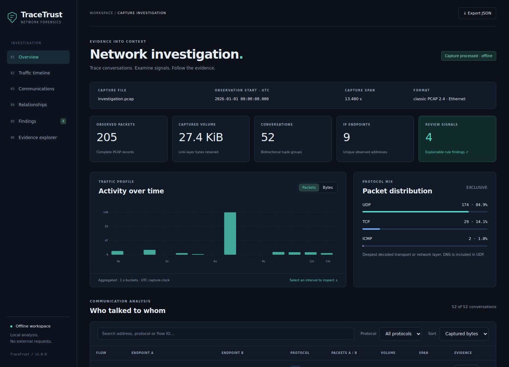
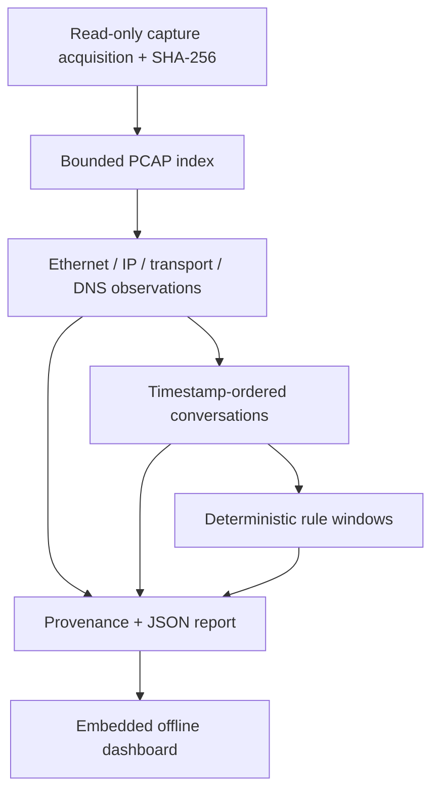

# TraceTrust

**Network Forensics & Threat Investigation Platform**  
Native C++20 analysis. Explainable signals. An offline investigation workspace.

> **Educational software, not a certified forensic tool.** TraceTrust does not
> replace validated acquisition procedures, Wireshark, Zeek, or professional
> judgment. A finding is a reason to investigate, not proof of an attack. A
> file hash does not establish a legal chain of custody.

Packet captures contain observations, not a complete account of what happened.
TraceTrust makes a small, inspectable part of that evidence usable: it reads a
local capture, summarizes communication, evaluates four explicit rules, and
links each finding to the frames that support it. It exports both machine-readable
JSON and a self-contained HTML dashboard without uploading anything.



## Implemented

- Native classic-PCAP reader with both byte orders, microsecond/nanosecond time,
  structural validation, explicit prefix analysis, and configurable resource limits.
- Ethernet, up to two VLAN tags, IPv4/IPv6, TCP/UDP, ICMP type observations and
  bounded UDP DNS header/question parsing.
- Bidirectional conversations with idle splitting, directional packet/byte counts,
  observed TCP flags, endpoint summaries, destination ports and traffic buckets.
- Four configurable sliding-window rules with counts, thresholds, timestamps,
  recommendations, limitations and frame/flow references.
- OpenSSL SHA-256 over the acquired file bytes, version/configuration provenance,
  UTC timestamps and visible warnings. No absolute input paths in reports.
- An offline dashboard with packet/byte timeline selection, protocol distribution,
  endpoint topology, conversation search, finding filters/sorting, pagination,
  evidence details and JSON download. No CDN, fonts or web server required.
- CTest, black-box CLI tests, sanitizer support, deterministic synthetic fixtures,
  browser tests, formatting/static checks and a GitHub Actions workflow.

## Build

The supported target is **64-bit Linux**, including Linux under WSL2. A C++20
compiler, CMake 3.20+, OpenSSL 3.0 development files and a build system are required.
Python 3.10+ runs the black-box tests; it is not the analysis engine. Native macOS
and Windows builds are not implemented.

On a normal Ubuntu 24.04 installation:

```bash
sudo apt-get update
sudo apt-get install -y g++ cmake ninja-build libssl-dev python3
cmake -S . -B build-release -G Ninja -DCMAKE_BUILD_TYPE=Release
cmake --build build-release --parallel 2
ctest --test-dir build-release --output-on-failure
```

For Debug, replace `build-release` with `build-debug` and `Release` with `Debug`.
For a runtime-only build, add `-DBUILD_TESTING=OFF`. To install without root:

```bash
cmake --install build-release --prefix "$PWD/local-install"
./local-install/bin/tracetrust --version
```

CMake never downloads dependencies. nlohmann/json 3.12.0 is vendored with its MIT
license; OpenSSL supplies SHA-256. These avoid implementing JSON escaping or
cryptography ad hoc. The CLI uses the standard library instead of a CLI framework.
See [THIRD_PARTY.md](THIRD_PARTY.md).

## A complete investigation

Run from the repository root after building. The included captures are synthetic,
use documentation IP ranges and `.test` names, and contain no private traffic.
Each output path **must be a new directory**; its parent must already exist.

```bash
./build-release/tracetrust --help
./build-release/tracetrust --version
mkdir -p reports

./build-release/tracetrust analyze examples/captures/baseline.pcap --output reports/baseline
./build-release/tracetrust analyze examples/captures/investigation.pcap --output reports/demo

# Save the actual defaults, then use a file and a deliberate CLI override.
./build-release/tracetrust --default-config > reports/analyst-config.json
./build-release/tracetrust analyze examples/captures/investigation.pcap \
  --output reports/adjusted --config reports/analyst-config.json --scan-ports 20

# JSON-only export is available when an interactive report is unnecessary.
./build-release/tracetrust analyze examples/captures/empty.pcap \
  --output reports/empty --json-only
```

Open `reports/demo/index.html` directly in a browser. Start with **Findings**, select
**Inspect evidence frames**, then open a frame to see its exact timestamp, ports,
flags, DNS questions, byte counts and original PCAP record offset. Selecting a
timeline interval or conversation also filters the evidence explorer. The adjacent
`report.json` contains the same data. Reports are generated, not updated in place:
choose a fresh output directory on each run.

The measured sample CLI output is:

```text
TraceTrust 1.0.0 | investigation.pcap
SHA-256  d478a7ea6b881a30e407b51ae6698d2d6877065d4ebb5a1febd01ab53f072119
Packets  205 | Conversations  52 | Findings  4
Reports written: report.json, index.html
```

The [sample investigation](examples/README.md) includes the scenario specification,
capture hashes, actual report and a walkthrough. GitHub displays HTML source;
download the repository and open `examples/investigation/index.html` locally to
interact with the committed report.

### Exit codes

| Code | Meaning |
| --- | --- |
| `0` | Report written; the record stream and supported packet path were processed. Findings may exist. This is not a security verdict. |
| `2` | Usage, configuration, I/O, unsupported global format, or other operation error. Output may be absent or partially written after an I/O failure. |
| `3` | Report written with a limited/damaged record prefix or partial/unsupported packet data. Inspect capture and per-frame warnings. |

All thresholds are integers. CLI values override the configuration file regardless
of argument order. Unknown keys, invalid values and repeated CLI threshold options
are rejected. `--default-config` lists every field and `--help` describes the options.

## Architecture



| Location | Responsibility |
| --- | --- |
| `src/capture/` | Stable read checks, file acquisition, PCAP record bounds |
| `src/protocols/` | Checked byte decoding; explicit incomplete/unsupported observations |
| `src/flows/` | Canonical tuples, direction counts, idle timeouts |
| `src/detection/` | Sliding windows and evidence-linked findings |
| `src/reporting/` | JSON structure, safe HTML embedding, exclusive output creation |
| `dashboard/` | Responsive local interface; assets compiled into the executable |
| `tests/` | Independent byte fixtures, CLI contracts and optional real-browser checks |
| `tools/` | Synthetic capture generation and repeatable performance measurements |

The input is buffered once under a size limit, so hashing and parsing refer to the
same acquired bytes. Decoders operate on checked spans. Conversation/rule ordering
is `(timestamp, frame number)`, while frame numbers retain capture-file order.
Memory is proportional to input and retained metadata. This favors auditability
and a portable HTML report over streaming multi-gigabyte captures. See the
[design document](docs/architecture.md) for contracts and trade-offs.

### Supported interpretation

| Layer | Scope |
| --- | --- |
| PCAP | Version 2.4; Ethernet link value exactly `1`; little/big endian; micro/nanoseconds. PCAPNG, other link types and link-field FCS flags are rejected. |
| Ethernet | 14-byte header and up to two 802.1Q/802.1ad VLAN tags. ARP is classified by EtherType only. |
| IPv4 | Addresses, TTL, header/total lengths; options skipped by validated length. All fragments skip transport decoding. |
| IPv6 | Addresses, hop limit; up to eight hop-by-hop/routing/destination/AH extensions. Fragment headers, ESP and jumbograms are unsupported. |
| TCP | Ports, sequence/acknowledgment numbers, header length and nine flag bits. No stream reassembly, retransmission deduplication or connection-state proof. |
| UDP | Ports and length checks. Captured bytes are not application transfer sizes. |
| ICMP/ICMPv6 | Type and address-pair grouping after a four-byte header check; no quoted-packet or echo-session reconstruction. |
| DNS | UDP port 53 header and up to 16 questions; bounded names/compression. No resource-record validation, DNS-over-TCP, encrypted DNS or alternative-port discovery. |

Protocol distribution is exclusive: each record contributes once to its deepest
decoded transport/network category, or `Other`. DNS is an additional observation
within UDP. Do not compare these labels directly with Wireshark's highest-layer
display-column labels such as HTTP or DNS.

## Rules and interpretation

| Rule | Default condition | Group | Priority |
| --- | --- | --- | --- |
| TT-A | At least 12 distinct destination ports in 10 s; TCP SYN without ACK or valid UDP headers | Source + destination + transport | Medium |
| TT-B | At least 5 TCP SYN-without-ACK packets in 10 s, including repeats | Directed address/port tuple | Medium |
| TT-C | At least 80 packets **or** 65,536 captured bytes in 1 s | Decoded IP source | Low |
| TT-D | At least 20 UDP DNS query packets in 10 s, QR=0 and at least one decoded question | IP source | Low |

These are fixed triage priorities, not learned risk scores. Windows include both
endpoints. At most one representative qualifying window is emitted per rule/group.
Counts cover its full evidence set; frame references retain the first 128 in
timestamp order when necessary and are labeled as a sample. A finding's flow
references correspond to those retained frames.

Read [detection-rules.md](docs/detection-rules.md) for the exact window selection,
threshold effects, false positives, false negatives and VLAN identity caveat.

### Report fields

- `capture`: basename, full acquired-file hash/size, PCAP settings, record-prefix
  completeness and structural warnings. A prefix analysis still hashes the full file.
- `summary`, `protocols`, `hosts`, `timeline`: observed counts and volume. Timeline
  bins are uniform `[start,end)` intervals, at most 120, with their width reported.
  Host send/receive totals count a packet at each endpoint and must not be summed
  as unique traffic volume.
- `flows`: `F000001` identifiers, endpoint A/B, optional ports, VLAN stack, direction
  counts, first/last times, TCP observations and all frame references. A is the
  earliest observed sender. A gap **greater than** 60 s starts a new conversation;
  tuple reuse without that gap may merge separate sessions. ICMP is grouped by
  addresses and protocol, without echo identifiers.
- `findings`: `A00001` identifiers, rule/priority, affected source/destination,
  observed counts, thresholds, configured window boundaries, first/last supporting
  observations, references, explanation, recommendations and limitations.
- `packets`: file-order frame number, PCAP record offset, UTC and exact epoch-ns
  timestamp, relative milliseconds, lengths, decoded fields, optional flow/DNS,
  observation status (`observed`, `partial`, `malformed`) and warnings.

UTC strings have nine fractional digits and `Z`. Microsecond inputs retain zeros
in the final three positions; this does not add precision. Epoch nanoseconds are
decimal **strings**, avoiding JavaScript integer precision loss. Relative
milliseconds are visualization values. Capture clocks can be wrong or reordered;
these fields do not prove when an external event actually happened.

## Tests, checks and reproduction

CTest runs the native groups plus CLI help/version and a black-box integration
test. The tests check endian/resolution variants, corrupt lengths, byte boundaries,
DNS pointers, protocol/flow semantics, exact rule thresholds, safe serialization,
file handling, evidence references and deterministic results. A fixed seed drives
2,500 mutated captures; this is a regression corpus, not exhaustive fuzzing.

```bash
cmake -S . -B build-asan -G Ninja -DCMAKE_BUILD_TYPE=Debug -DTRACETRUST_SANITIZERS=ON
cmake --build build-asan --parallel 2
ASAN_OPTIONS=detect_leaks=1 UBSAN_OPTIONS=halt_on_error=1 \
  ctest --test-dir build-asan --output-on-failure

python3 -m venv .venv
.venv/bin/pip install -r requirements-dev.txt
.venv/bin/clang-format --dry-run --Werror include/tracetrust/*.hpp src/*.cpp src/*/*.cpp tests/tests.cpp
node --check dashboard/app.js

# Optional browser tests and screenshots; browser installation needs internet.
.venv/bin/python -m playwright install chromium
.venv/bin/python tests/dashboard_test.py --executable build-release/tracetrust --screenshots docs/screenshots

# Rebuild the small captures independently; existing directories are refused.
.venv/bin/python tools/generate_fixtures.py --output regenerated
diff -r examples/captures regenerated

# Optional Cppcheck installation: sudo apt-get install cppcheck
cppcheck --project=build-release/compile_commands.json --enable=warning,performance,portability \
  --inline-suppr --suppress=missingIncludeSystem '--suppress=*:*/third_party/*' \
  --error-exitcode=1 --max-configs=1
```

Third-party headers are excluded from Cppcheck diagnostics; project source and tests
remain checked. Actual build/test results, exact environment commands and the
LeakSanitizer environment restriction are recorded in [validation.md](docs/validation.md).
The CI workflow is supplied for future pushes; a GitHub-hosted run is not claimed.

## Measured performance

The [benchmark record](docs/benchmark.md) contains real Release-build measurements
at 1,000, 10,000 and 50,000 synthetic packets, including raw CSV/JSON. The timed work
includes acquisition, hashing, analysis, JSON and HTML serialization, and output
sync. It is a narrow synthetic workload in a shared container, not a claim of
production throughput or superiority over another analyzer.

```bash
.venv/bin/python tools/benchmark.py --executable build-release/tracetrust --output reports/benchmark
```

## Safety and limitations

Read [SECURITY.md](SECURITY.md) before using sensitive captures.

- The engine makes no network requests. Reports contain sensitive metadata even
  without payloads; review addresses and DNS questions before publishing.
- Sources are opened read-only; terminal symlinks and special files are refused.
  Parent paths are trusted. Source change checks are best effort and do not create
  an atomic acquisition of a live file. Reading may update filesystem `atime`.
- Output files/directories are created exclusively. A write failure may leave
  partial new output; no existing file is intentionally overwritten.
- Defaults: 128 MiB acquired-file limit and 100,000 analyzed frames; hard maxima:
  512 MiB and 200,000 frames. Raising limits can use substantial RAM, especially
  with many DNS questions. A frame limit yields a clearly marked prefix report.
- No checksum validation, stream/IP reassembly, decryption, application byte
  accounting, clock correction, signed reports or audit hash chain.
- No native PCAPNG, non-Ethernet formats, native macOS/Windows support, or live
  capture. No empirical attack-detection accuracy is established.
- The browser shows at most 18 topology nodes and six busiest host bars. Remaining
  endpoints are retained in JSON and the conversation explorer. Tables paginate;
  all retained packet metadata still loads into browser memory.
- TShark and Zeek were unavailable in the validation environment. No external-tool
  agreement is claimed. [Comparison notes](docs/comparison.md) give offline commands
  and explain which semantics can reasonably be compared.

## Next work

Unimplemented extensions: streaming report storage, PCAPNG/multiple interfaces,
tested additional operating systems, IP/TCP reassembly, VLAN-aware detector
identity, resource-record parsing, longer-running coverage-guided fuzzing, and
evaluation against labeled captures with independently reviewed ground truth.

## License

MIT. See [LICENSE](LICENSE) and [THIRD_PARTY.md](THIRD_PARTY.md).
