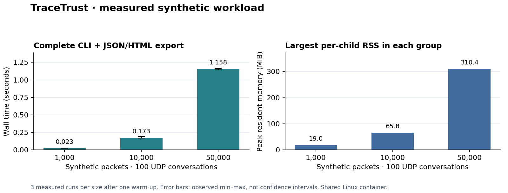

# Measured synthetic workload

These are actual Release-build observations from a single shared Linux container,
not predictions or a comparison with Wireshark/Zeek. Each size contains 100 fixed
UDP conversations between two documentation IPv4 addresses, a 108-byte synthetic
payload, and 100-microsecond inter-packet spacing. Generation sends no traffic.

The timer covers the child CLI process: file acquisition, SHA-256, decoding,
aggregation, rules, complete per-frame JSON and HTML serialization, file writes and
`fsync`. Capture construction and report inspection are outside the timed region.
One untimed warm-up per size precedes three measured runs, so input reads may be
cached. Per-child peak RSS comes from Linux `wait4`, not a cumulative child maximum.

| Packets | Median wall time | Observed min–max | Maximum peak RSS |
| ---: | ---: | ---: | ---: |
| 1,000 | 0.0231 s | 0.0217–0.0246 s | 19.0 MiB |
| 10,000 | 0.1726 s | 0.1706–0.1932 s | 65.8 MiB |
| 50,000 | 1.1576 s | 1.1441–1.1623 s | 310.4 MiB |



Raw per-run data: [CSV](measurements/measurements.csv) and
[JSON with environment](measurements/measurements.json). Environment: GCC 13.3.0,
Release (`-O3 -DNDEBUG`), OpenSSL 3.0.13, x86_64 Ubuntu 24.04.3, nine visible CPUs;
the analysis engine itself is single-threaded. CPU allocation and storage are
shared and not controlled. Values should not be generalized to another host.

Memory grows because this implementation retains observations and constructs a
full JSON document and self-contained HTML string. DNS-heavy captures, more
conversations, longer names, many findings and larger frame sizes can behave
very differently. The HTML browser also loads the full retained dataset. These
measurements do not establish detector accuracy, denial-of-service resistance,
maximum throughput, or performance on multi-gigabyte captures.

## Reproduce

After the Release build and optional development dependencies:

```bash
mkdir -p reports
.venv/bin/python tools/benchmark.py --executable build-release/tracetrust --output reports/new-benchmark
```

The output directory must be new. Each measured run retains its generated report,
stdout/stderr and exact metrics; large run artifacts are intentionally excluded
from the source archive. To render the chart (optional matplotlib 3.10+, locally
rendered with 3.10.8):

```bash
python3 tools/plot_benchmark.py docs/measurements/measurements.json docs/benchmark.png
```

Error bars show the observed minimum and maximum of three runs, not a statistical
confidence interval. No competitor was timed and no superiority claim is made.
