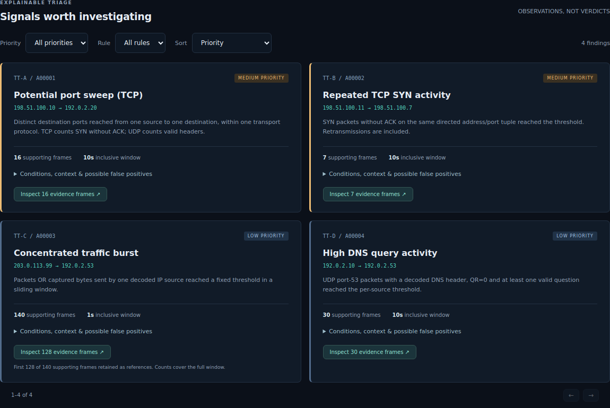

# A reproducible synthetic investigation

Start by opening `investigation/index.html` in a browser. It is the actual generated
report for `captures/investigation.pcap`; `investigation/report.json` contains the
same analysis. No server or network access is required.

## Scenario specified before evaluation

The first 12 packets describe a small benign observation: one DNS exchange, six
TCP headers with a short HTTP-shaped payload exchange, two IPv6 UDP messages and
an ICMP echo/reply. TraceTrust classifies transport headers; it does not claim to
validate the HTTP exchange or reconstruct a complete TCP connection.

Four deliberately concentrated patterns follow. They are synthetic test stimuli,
not a claim that the same pattern in a real network must be malicious.

| Frames | Pattern | Expected default result |
| --- | --- | --- |
| 1–12 | Baseline traffic, 4 conversations | No findings on `baseline.pcap` alone |
| 13–28 | One source sends 16 SYNs to 16 destination ports in 0.90 s | TT-A: 16 ports, 16 frames |
| 29–35 | Seven identical-sequence SYNs on one directed tuple in 1.20 s | TT-B: 7 packets; retransmissions possible |
| 36–175 | 140 UDP packets in 0.417 s, one source/destination tuple | TT-C: 140 packets; first 128 references displayed |
| 176–205 | 30 DNS query packets in 3.48 s | TT-D: 30 packets |

The expectation file is `expectations.json`. Its values were specified separately
from the analyzer report. The black-box test compares the native output against
those values and checks hash preservation and evidence references.

## Observed output

The full scenario produced **205 packets, 52 conversations, 9 IP endpoints and four
findings**, spanning 13.480 seconds. Exclusive protocol counts were TCP 29, UDP 174,
and ICMP 2. The DNS overlay contains 32 packets, included in the UDP total.

SHA-256 of `investigation.pcap`:

```text
d478a7ea6b881a30e407b51ae6698d2d6877065d4ebb5a1febd01ab53f072119
```



1. In **Activity over time**, select the 7 s interval. The evidence explorer shows
   the 140-packet UDP burst, paginated in groups of 40.
2. In **Findings**, filter to TT-B and inspect a supporting frame. The repeated SYNs
   use sequence 555. The evidence supports repeated SYN activity; it cannot establish
   seven separate connections or their success/failure.
3. Inspect TT-D, then a query frame. DNS question names use `q0.demo.test` through
   `q29.demo.test`; questions and header flags are decoded, not resource records.
4. In **Communication map**, choose `203.0.113.99` to filter the conversation table.
   Clear that filter to restore all 52 conversations.
5. Review configuration and the SHA-256 in **Investigation provenance** before
   sharing either report.

Rerun with `--scan-ports 20`: TT-A disappears, leaving three findings. This verifies
that configuration changes behavior; it does not measure a calibrated false-positive
rate. The same capture hash remains in both reports.

## Reproduce

```bash
mkdir -p reports
./build-release/tracetrust analyze examples/captures/investigation.pcap --output reports/new-investigation
python3 tests/cli_integration.py ./build-release/tracetrust .
```

The fixtures can be regenerated using `dpkt==1.9.8` (development dependency only):

```bash
.venv/bin/python tools/generate_fixtures.py --output regenerated
diff -r examples/captures regenerated
```

`captures/manifest.json` records file hashes and sizes. Capture timestamps are fixed
at 2026-01-01 UTC, beginning at epoch 1767225600. Ethernet addresses are locally
administered synthetic values; IPs are documentation ranges. No packet is transmitted.

Other fixtures exercise an empty capture, big-endian nanosecond timestamps, a
damaged tail (exit 3 with the valid 12-frame prefix), and unsupported PCAPNG (exit 2).
The HTML report's generation timestamp reflects the actual run and changes on
reproduction. The capture bytes and deterministic analysis fields do not.
